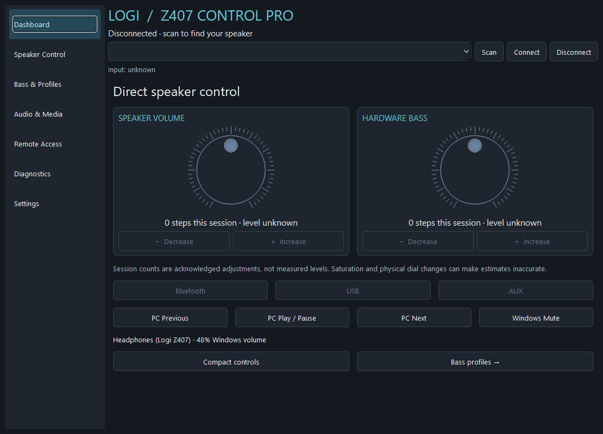

# Logi Z407 Control Pro

**Native Windows control for Logitech Z407 speakers — with direct hardware bass adjustment.**

Logi Z407 Control Pro is an independent desktop application that communicates with the Logitech Z407 over Bluetooth Low Energy (BLE). Adjust the speaker’s hardware bass and volume, switch audio inputs, and manage Windows audio from one native interface.

Built with Python, PySide6, Bleak, and Windows Core Audio. Runs locally without accounts, API keys, Logitech G HUB, or cloud services.

> **Status: v0.1.0 · early release.** Real Z407 command acknowledgments and reconnect cycles have been tested. Audible effects, power-loss recovery, and final installer execution still need acceptance testing. See [test results](docs/TESTING.md) and [build results](docs/BUILD_RESULTS.md).



## Contents

- [Why this app exists](#why-this-app-exists)
- [Features](#features)
- [Requirements](#requirements)
- [Installation](#installation)
- [Connecting your speaker](#connecting-your-speaker)
- [Hardware bass and profiles](#hardware-bass-and-profiles)
- [Speaker volume and input selection](#speaker-volume-and-input-selection)
- [Windows audio and media](#windows-audio-and-media)
- [Tray, shortcuts, and settings](#tray-shortcuts-and-settings)
- [How the BLE controller works](#how-the-ble-controller-works)
- [Development and testing](#development-and-testing)
- [Building Windows distributions](#building-windows-distributions)
- [Troubleshooting](#troubleshooting)
- [Limitations and roadmap](#limitations-and-roadmap)
- [Contributing](#contributing)
- [Credits and license](#credits-and-license)

## Why this app exists

The Z407’s physical dial handles everyday playback and bass adjustments, but software control can make those adjustments more accessible from a Windows desktop. This project brings the documented BLE remote protocol into a dedicated desktop application, with particular attention to hardware bass control and connection reliability.

The application keeps three things distinct:

| Control | What it changes |
| --- | --- |
| Hardware bass | Bass adjustment inside the Z407 speaker system, through BLE commands |
| Speaker volume | The speaker’s hardware volume, through BLE commands |
| Windows audio | PC master volume, mute, and supported application audio sessions |

## Features

### Direct Z407 hardware control

- Scan for devices advertising the documented Z407 BLE service.
- Select a device and establish its control connection.
- Increase and decrease hardware bass and speaker volume.
- Use relative dials, mouse-wheel adjustments, and step buttons.
- Request Bluetooth, USB, or AUX input.
- Send speaker playback commands for the Bluetooth source.
- Track command acknowledgments and hardware input-change notifications.

### Bass profiles

- Establish a manual reference level by listening.
- Apply bounded bass offsets relative to that reference.
- Built-in profiles: Deep Bass, Balanced, Music, Gaming, Movies, and Night Mode.
- Save custom named offsets.
- Invalidate the reference after physical dial use or uncertain state.

### Windows desktop integration

- Windows master volume and mute through Core Audio.
- Playback output enumeration and default-device identification.
- Supported per-application audio-session volume controls.
- PC previous, play/pause, and next media buttons.
- System tray controls and close-to-tray behavior.
- Compact controls with always-on-top behavior.
- Configurable, opt-in global shortcuts with conflict reporting.
- Dark and light themes.
- Local preferences, preference export, and diagnostic report export.
- Optional startup shortcut through the installer.

### Reliability

- Dedicated asynchronous BLE worker, separate from the UI thread.
- Serialized commands with acknowledgment timeouts.
- Conservative write spacing and bounded pending-command count.
- Bounded automatic reconnect attempts with exponential backoff.
- Stale-command rejection after a connection change.
- No automatic replay of a command whose outcome is uncertain.
- Single-instance application lock and shutdown cleanup.

## Requirements

| Component | Requirement |
| --- | --- |
| Operating system | Windows 11 x64; Windows 10 compatibility is intended but has not been separately validated |
| Speaker | Logitech Z407 |
| Bluetooth | A working BLE-capable adapter with Windows Bluetooth enabled |
| Standalone distribution | No separate Python installation required |
| Running from source | Python 3.12 or 3.13 x64 recommended; tested with Python 3.13.9 |
| Internet | Needed to download dependencies during setup; unnecessary during normal operation |

The physical Z407 dial or another controller may hold the speaker’s only BLE remote connection. Bluetooth audio pairing and the BLE control connection are separate.

## Installation

### Windows installer

When using a published release, download its installer asset. A locally built installer is written to:

```text
dist/installer/LogiZ407ControlPro-Setup.exe
```

The installer uses a per-user installation directory and offers optional desktop and Windows-startup shortcuts. It also provides a Start Menu entry and uninstaller. Preferences are preserved when uninstalling.

**The current artifacts are unsigned.** Windows Smart App Control blocked the final executable on the development machine. Installer compilation succeeded, but final installation and uninstallation were not executed. A signed release is still needed for environments that require approved executable signatures. See [the build report](docs/BUILD_RESULTS.md).

### Portable distribution

Keep the complete application directory together:

```text
LogiZ407ControlPro/
├── LogiZ407ControlPro.exe
├── _internal/
└── licenses/
```

Launch `LogiZ407ControlPro.exe`. Moving only the executable will leave out its required runtime files. The same unsigned-executable restrictions apply to this distribution.

### Run from source

Download or clone the repository, open PowerShell in its root directory, then run:

```powershell
python -m venv .venv
.\.venv\Scripts\python.exe -m pip install -r requirements.txt
.\.venv\Scripts\python.exe -m app.main
```

For a launch without a console window:

```powershell
.\.venv\Scripts\pythonw.exe run.py
```

The original development workspace also includes a local source shortcut and `scripts/launch.ps1`. Those use its workspace Python installation; the shortcut contains local paths and is not a portable release artifact.

## Connecting your speaker

1. Power on the Z407 and enable Windows Bluetooth.
2. Release the physical dial’s control connection: remove its batteries or leave it untouched for about five minutes. Close other Z407 controller applications.
3. Open Logi Z407 Control Pro and click **Scan**.
4. Select the discovered device and click **Connect**.
5. Wait for **Connected · protocol handshake acknowledged** before using hardware controls.

The app does not reset Bluetooth adapters, remove Windows pairings, disconnect unrelated devices, or factory-reset speakers.

You can enable connection to the preferred speaker on launch in Settings. Unexpected disconnections can trigger up to five reconnect attempts. After that, the app asks you to check the device and reconnect manually.

## Hardware bass and profiles

Bass controls send the documented Z407 hardware commands directly to the speaker. They do not change Windows volume or apply a software equalizer.

### What the displayed count means

The documented protocol has relative bass and volume commands but no absolute level readback. Consequently, the app displays acknowledged adjustment steps, never a fabricated speaker percentage.

A count is an estimate of adjustments made by the app. It cannot establish the speaker’s actual level: the physical dial may change it, and commands at a hardware limit may not produce another audible step.

### Establish a bass baseline

1. Connect the speaker.
2. Adjust bass by listening until it reaches your preferred reference.
3. Open **Bass & Profiles**.
4. Select **Use current bass as my baseline** and confirm.
5. Choose a profile and review the requested step change before applying it.

Establishing a baseline records relative zero. It does not measure or change the current bass level, and it does not sweep the speaker to minimum or maximum.

### Default profile offsets

| Profile | Steps from your manual baseline |
| --- | ---: |
| Deep Bass | +3 |
| Balanced | 0 |
| Music | +1 |
| Gaming | +2 |
| Movies | +2 |
| Night Mode | −2 |

These names are user preferences, not official Logitech tuning curves or measured bass levels. Custom offsets can be saved between −6 and +6. A single profile application is limited to six adjustment steps.

After reconnection or an uncertain command, establish a new baseline. If you use the physical dial, select **Invalidate baseline after physical dial use** before applying another profile. The app cannot detect physical dial movement automatically.

## Speaker volume and input selection

Hardware volume uses relative up/down commands. The displayed session count is separate from the Windows master-volume percentage.

The Bluetooth, USB, and AUX buttons send input requests. The interface distinguishes:

- **Hardware reported:** an input-change notification was received.
- **Last requested (acknowledged):** the request was acknowledged, but no current-input report was received.
- **Unknown:** no reliable current state is available.

A command acknowledgment confirms protocol reception. It does not measure acoustic output.

## Windows audio and media

Open **Audio & Media** to view the default playback output, available active outputs, Windows master volume, and supported application audio sessions.

- Release the master-volume slider to apply the selected Windows volume.
- Use the mute button to toggle Windows audio mute.
- Refresh outputs and sessions to update the list and access per-application sliders.
- Use the dashboard’s **PC** media buttons for Windows multimedia-key controls.
- Use the separately labeled **Speaker** playback buttons for the Z407 Bluetooth source.

Media-key behavior depends on the active player. Track title, artist, artwork, and playback metadata are not available in this version. Default playback-device selection remains in Windows Settings.

## Tray, shortcuts, and settings

Closing the main window minimizes it to the tray by default. Double-click the tray icon to restore it, or use its menu for quick volume, bass, input, reconnect, and exit actions.

Choose **Exit** to stop the application and release its BLE connection. Close-to-tray behavior can be changed in Settings.

### Default global shortcuts

Global shortcuts are disabled until you enable them in Settings.

| Action | Default shortcut |
| --- | --- |
| Speaker volume up | `Ctrl + Alt + Up` |
| Speaker volume down | `Ctrl + Alt + Down` |
| Hardware bass up | `Ctrl + Alt + Right` |
| Hardware bass down | `Ctrl + Alt + Left` |

Shortcut combinations are configurable. If registration fails because a combination is unavailable or already in use, the application reports the conflict.

### Local preferences and privacy

Preferences are stored at:

```text
%LOCALAPPDATA%\LogiZ407ControlPro\settings.json
```

Settings include theme, tray behavior, preferred speaker, connection preferences, global shortcuts, and bass profiles. Preferences can be exported as JSON.

The app runs without accounts, telemetry, cloud services, or a remote-control network listener. Diagnostic exports redact MAC-address patterns, but other local information may remain in operating-system error messages. Review reports before sharing them.

## How the BLE controller works

The implementation uses the protocol documented by freundTech, with local compatibility findings recorded in [PROTOCOL.md](docs/PROTOCOL.md).

| GATT component | UUID |
| --- | --- |
| Control service | `0000fdc2-0000-1000-8000-00805f9b34fb` |
| Command characteristic | `c2e758b9-0e78-41e0-b0cb-98a593193fc5` |
| Response characteristic | `b84ac9c6-29c5-46d4-bba1-9d534784330f` |

The controller subscribes to responses, sends `8405`, waits for `d40501`, then sends `8400`. Local hardware emitted either `d40001` or `d40003` as its positive completion response on different connections; both variants are accepted.

Bass uses `8000` / `8001`, volume uses `8002` / `8003`, and Bluetooth / AUX / USB requests use `8101` / `8102` / `8103`. Individual controls wait for the corresponding application-level acknowledgment.

Current engineering limits are a 100 ms minimum write interval, eight pending commands, four-second acknowledgment timeouts, and five reconnect attempts. These are conservative policies pending wider hardware testing.

### Project structure

```text
app/
├── main.py                  # Application entry, instance lock, diagnostics flags
├── services.py              # Asynchronous BLE worker and Qt signal bridge
├── profiles.py              # Relative state and bounded profile calculations
├── bluetooth/
│   ├── protocol.py          # Documented UUIDs, payloads, and acknowledgments
│   └── controller.py        # Discovery, handshake, serialized writes, recovery
├── audio/windows.py         # Core Audio and Windows media controls
├── storage/settings.py      # Local preferences and atomic persistence
└── ui/
    ├── window.py            # Desktop pages, compact controls, and system tray
    └── hotkeys.py           # Windows global shortcut registration
assets/                      # Original icon and license texts
docs/                        # Protocol, test, build, and troubleshooting reports
scripts/                     # Build tools and explicit hardware-check scripts
tests/                       # Automated simulated-device and UI tests
packaging/installer.iss       # Per-user Windows installer definition
```

## Development and testing

Install development dependencies and run the suite:

```powershell
.\.venv\Scripts\python.exe -m pip install -r requirements-dev.txt
.\.venv\Scripts\python.exe -m pytest -q
```

`requirements-lock.txt` records the exact original build environment. The automated suite currently contains **15 passing tests**, covering protocol encoding, handshake variants, acknowledgments, queue behavior, stale commands, reconnects, profiles, preferences, shortcut parsing, Qt/tray construction, audio API dispatch, and shutdown cancellation.

Simulated clients exist only under `tests/`. Production does not silently fall back to a simulated device.

### Actual hardware testing

The local Z407 acknowledged volume down/up, bass down/up, and all three input requests. AUX and USB input-change notifications were observed. Three manual disconnect/reconnect cycles completed successfully.

Audible bass/volume effects, recovery after a physical power interruption, physical-dial contention, and long-duration soak testing remain unverified. Windows audio enumeration was tested on real endpoints; player behavior and audio writes still need interactive acceptance checks.

Run hardware checks explicitly; they are not part of pytest:

```powershell
# Sends one volume down/up and bass down/up sequence, then reconnects.
.\.venv\Scripts\python.exe scripts/hardware_check.py

# Also switches Bluetooth → AUX → USB, leaving USB requested.
.\.venv\Scripts\python.exe scripts/hardware_check.py --include-inputs

# Performs three reconnect cycles, requesting USB each time.
.\.venv\Scripts\python.exe scripts/reconnect_check.py
```

See [TESTING.md](docs/TESTING.md) for the distinction between simulated tests, real protocol results, and unexecuted acceptance checks.

## Building Windows distributions

Install development dependencies and Inno Setup, then make `ISCC.exe` available on PATH or at `packaging/inno/ISCC.exe`. The original build used Inno Setup 6.7.4.

From an activated development environment:

```powershell
.\.venv\Scripts\Activate.ps1
.\scripts\build.ps1
```

The script uses `.python/python.exe` if that workspace runtime exists; otherwise it uses `python` on PATH. It runs tests, builds the windowed PyInstaller directory, applies the documented runtime-packaging correction, collects dependency licenses, smoke-tests the executable, and compiles the installer.

Outputs:

```text
dist/LogiZ407ControlPro/LogiZ407ControlPro.exe
dist/installer/LogiZ407ControlPro-Setup.exe
```

If signing policy blocks execution, `-PackageWithoutLaunch` explicitly skips the packaged startup test. Any resulting release must report that verification gap; this switch does not sign the binary or change Windows security settings.

Generate a source archive with:

```powershell
.\.venv\Scripts\python.exe scripts/source_archive.py
```

See [BUILD_RESULTS.md](docs/BUILD_RESULTS.md) for actual build outcomes, including the unsigned final-executable restriction.

## Troubleshooting

| Problem | What to check |
| --- | --- |
| No speaker found | Speaker power, range, Windows Bluetooth, and ownership by the physical dial or another controller |
| Scan fails | BLE adapter availability and Windows Bluetooth configuration; inspect the diagnostic error |
| Handshake times out | Release the physical dial’s connection, close other controllers, and reconnect |
| Required GATT characteristic missing | Confirm the selected hardware is a supported Z407; do not send guessed commands |
| Command acknowledgment times out | The command may already have acted; reconnect and listen before making further adjustments |
| Profile sounds different than expected | Invalidate the baseline and establish a new reference by listening |
| PC media buttons have no effect | Check that the active player supports Windows multimedia keys |
| Window appears closed | Restore it from the tray, or change close-to-tray behavior |
| Unsigned executable is blocked | Use the documented source setup or an approved signed build |

Export a report from **Diagnostics** when investigating a problem. More guidance is available in [TROUBLESHOOTING.md](docs/TROUBLESHOOTING.md).

## Limitations and roadmap

The following capabilities are **not implemented** in v0.1.0:

- Absolute hardware bass or speaker-volume readback; no such API is documented in the studied protocol.
- Automatic detection of physical dial adjustments.
- Mobile/LAN remote control, QR pairing, or authentication services.
- A system-wide software equalizer or audio-processing driver.
- Track metadata, artist information, album artwork, or media-session playback state.
- Continuous adapter-radio state monitoring.
- Preference import, configurable adjustment sensitivity, or additional UI languages.
- Default Windows playback-output switching.
- Signed distribution and complete installer acceptance validation.

Potential future work includes signed releases, broader hardware validation, richer Windows media integration, and authenticated optional remote control. A software EQ should only be added with a real compatible processing engine and explicit dependency handling.

## Contributing

Bug reports, documented hardware observations, usability improvements, and focused pull requests are welcome.

For a connection issue, include Windows version, application version, Bluetooth-adapter details if known, reproduction steps, whether the physical dial was active, and a reviewed diagnostic export. State whether findings come from real hardware or simulation.

For code changes:

1. Keep hardware control, Windows audio, UI, and persistence responsibilities separate.
2. Document evidence for protocol additions; do not guess commands or capabilities.
3. Add meaningful tests for changed behavior and run the existing suite.
4. Keep device state honest: requested, acknowledged, estimated, and hardware-reported states have different meanings.
5. Report unexecuted hardware checks explicitly.
6. Keep reference-source licensing and attribution intact.

## Credits and license

Protocol research and reference applications:

- [freundTech/logi-z407-reverse-engineering](https://github.com/freundTech/logi-z407-reverse-engineering)
- [Androrama’s Windows remote-control reference](https://github.com/androrama/Logitech-Z407-Remote-Control-Web-App---Windows)
- [Androrama’s Linux remote-control reference](https://github.com/androrama/Logitech-Z407-Remote-Control-Web-App---Linux)

This application is independently implemented using documented protocol facts. Reference application code and artwork are not included in the distribution. See [THIRD_PARTY_NOTICES.md](THIRD_PARTY_NOTICES.md) for attribution and dependency notices.

**Project license: not yet declared.** A project-level `LICENSE` file still needs to be selected and added before presenting the repository as a licensed open-source release. Dependency license texts are included separately; they do not declare the license of this application.

This project is independent and is not affiliated with, authorized by, or endorsed by Logitech. Logitech and Z407 are trademarks of their respective owners.
